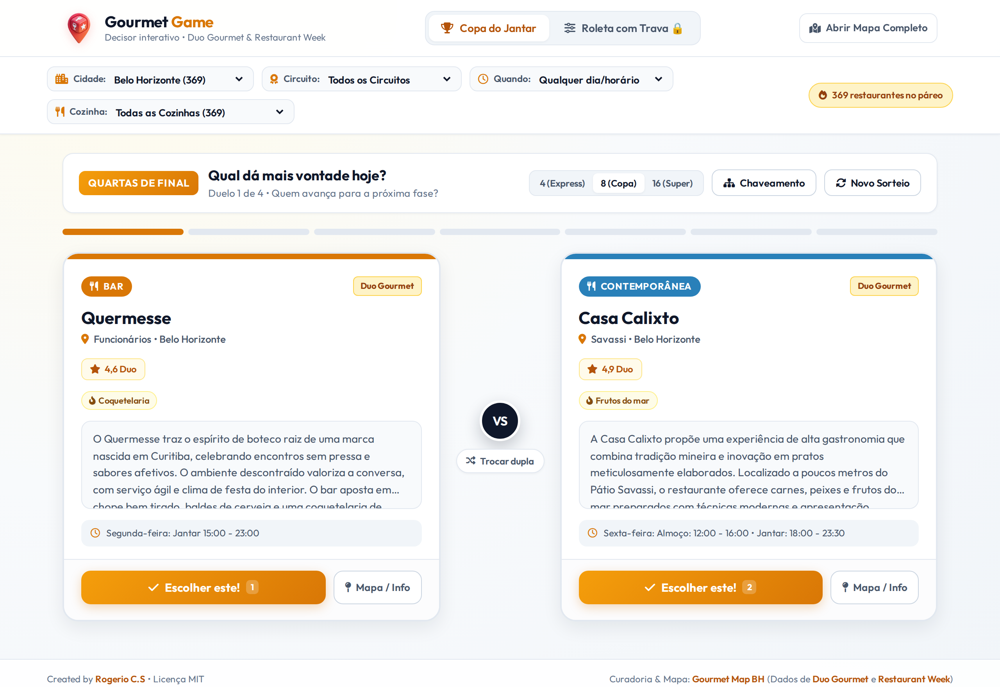
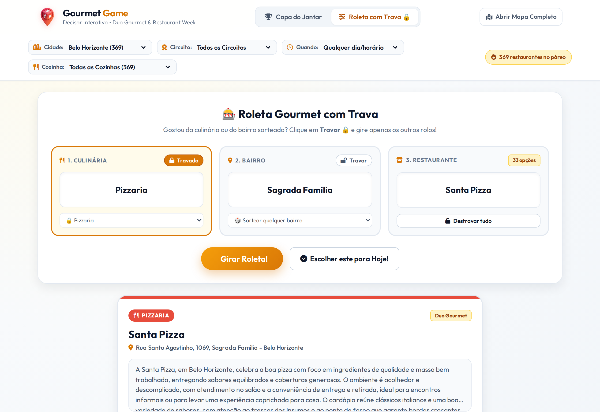
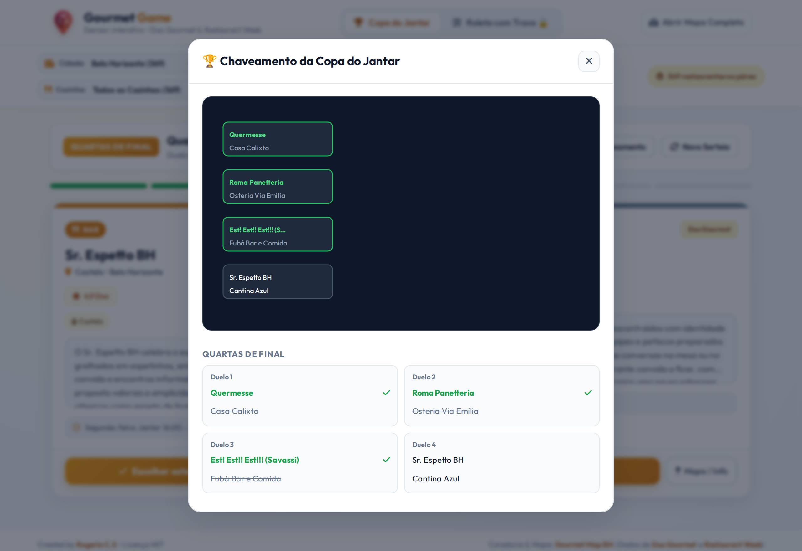
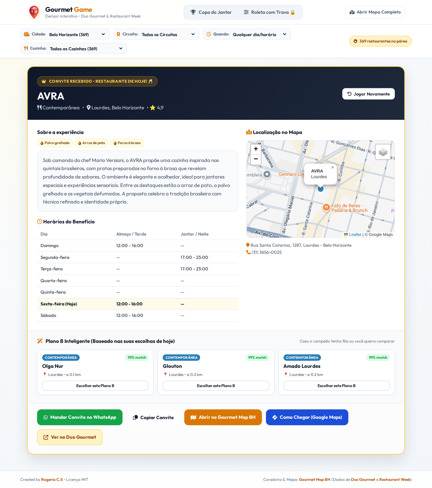
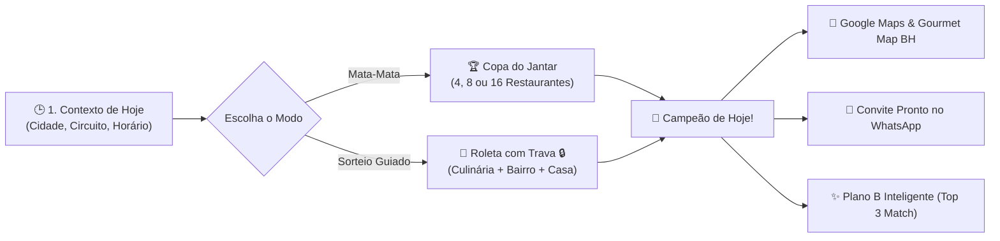

<div align="center">

# 🎲 Gourmet Game BH — Qual o Seu Restaurante de Hoje?

> **Acabe com a indecisão de "onde vamos comer hoje?" em menos de 30 segundos.**  
> Um mini-game interativo com **1.209 restaurantes** mapeados dos circuitos **Duo Gourmet** e **Restaurant Week** em Belo Horizonte, região e São Paulo.

### 👉 **Acesse e jogue aqui:** [https://rogerioc.github.io/gourmet-game/](https://rogerioc.github.io/gourmet-game/)

[](https://rogerioc.github.io/gourmet-game/)
[](https://rogerioc.github.io/gourmet-map/)
[](https://github.com/rogerioc/gourmet-game)
[](LICENSE)

</div>

---

## 📸 Preview do Jogo

| 🏆 Modo 1: Copa do Jantar (Mata-Mata 1x1) | 🎰 Modo 2: Roleta Gourmet com Trava 🔒 |
| :---: | :---: |
|  |  |
| *Compare 2 restaurantes por vez com notas, horários e pratos em destaque.* | *Gostou da culinária ou do bairro? Trave no cadeado 🔒 e gire apenas o resto!* |

| 🗺️ Chaveamento Visual em SVG (`SVG.js`) | 👑 Tela do Campeão + Mapa + Plano B Inteligente |
| :---: | :---: |
|  |  |
| *Árvore eliminatória renderizada dinamicamente em SVG.* | *Localização no Google Maps, horários do dia, convite WhatsApp e 3 sugestões de Plano B.* |

---

## 🎯 Como Funciona (Fluxo de Decisão)



---

## ✨ Principais Recursos

| Recurso | Como ajuda na prática |
|---|---|
| **🟢 Filtro "Aberto Agora" & Momento** | Lê a tabela real de horários (almoço e jantar de segunda a domingo) para sortear apenas lugares que funcionam no dia/turno que você quer sair. |
| **🔥 Tags de Pratos em Destaque** | Extração automatizada (estilo *No-AI-Slop*) de especialidades do cardápio (*Forno à brasa*, *Fermentação natural*, *Risoto*, *Parrilla*, *Drinks autorais*) em mais de 540 casas. |
| **🏆 Copa do Jantar (4, 8 ou 16)** | Torneio de eliminação rápida sem repetir redes/franquias na mesma chave, com atalhos de teclado (`1`/`⬅️` e `2`/`➡️`) e opção de trocar dupla. |
| **🎰 Roleta Relacional com Trava 🔒** | Trave a **Culinária** ou o **Bairro** e gire os demais rolos sabendo que o motor filtra apenas combinações 100% válidas. |
| **✨ Plano B Inteligente (Motor de Afinidade)** | Aprende com os seus votos durante a Copa e combina com a distância geográfica (*Haversine*) para recomendar **3 alternativas próximas** caso o vencedor esteja com fila. |
| **📲 Deep-Link de Convite (`?winner=slug`)** | Gera um link direto para mandar no WhatsApp do casal ou grupo de amigos já abrindo na tela do restaurante escolhido. |

---

## 🛠️ Stack & Ferramentas do [Awesome AI Arsenal](https://github.com/rogerioc/awesome-ai-arsenal)

Este projeto foi construído em **Vanilla HTML5 + CSS3 + JavaScript (Zero-Build)** para rodar com performance máxima no GitHub Pages, incorporando ferramentas e padrões do repositório **[awesome-ai-arsenal](https://github.com/rogerioc/awesome-ai-arsenal)**:

- **[`SVG.js`](https://github.com/svgdotjs/svg.js)** *(Cat. 6 — Design & Arquitetura Visual)*: Renderização vetorial da árvore do chaveamento da Copa com curvas de Bézier.
- **[`No AI Slop`](https://github.com/petergyang/no-ai-slop)** *(Cat. 9 — DevTools)*: Pipeline em `sync_data.py` para limpar textos genéricos de IA e extrair tags reais de pratos.
- **[`Surprise` (Conceito de Afinidade)](https://github.com/NicolasHug/Surprise)** *(Cat. 12 — Ciência de Dados)*: Algoritmo client-side de recomendação híbrida (votos da sessão + proximidade em km + nota) para o *Plano B Inteligente*.
- **[`Umami Analytics`](https://github.com/umami-software/umami)** *(Cat. 11 — Self-Hosted / Privacidade)*: Telemetria de eventos (`champion_selected`, `whatsapp_invite`, `open_gourmet_map`) 100% sem cookies e compatível com a LGPD.
- **Leaflet.js + Google Maps Tiles**: Mini-mapa interativo integrado sem necessidade de chaves pagas.
- **Modern Web Platform APIs**: `document.startViewTransition()` para transições fluidas, `<dialog closedby="any">` nativo no top-layer e respeito a `@media (prefers-reduced-motion)`.

---

## 🚀 Rodando Localmente e Atualizando Dados

1. **Abrir o jogo localmente:**
   ```bash
   cd gourmet-game
   python3 -m http.server 8080
   # Acesse http://localhost:8080
   ```

2. **Sincronizar base de restaurantes (após atualizar os scrapers na pasta raiz):**
   ```bash
   python3 sync_data.py
   ```

---

## 📄 Licença & Créditos

Distribuído sob a **[Licença MIT](LICENSE)**.  
Idealizado e desenvolvido por **[Rogerio C.S](https://rogerioc.github.io/about/)**. Ao reutilizar, adaptar ou publicar este projeto, mantenha os créditos ao autor original.
